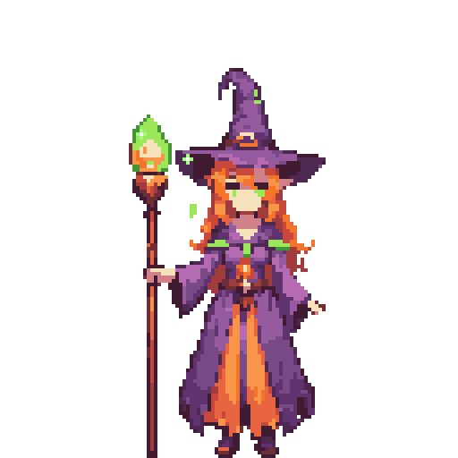
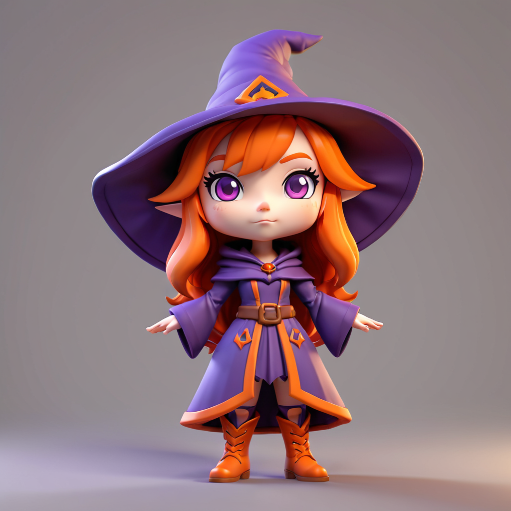
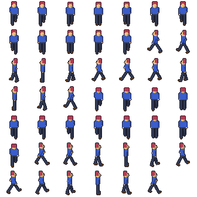

# Puretty Sprites

A toolkit for making pixel-art sprites with an AI agent, built around [LibreSprite](https://libresprite.github.io). It started from [aseprite-mcp](https://github.com/diivi/aseprite-mcp) and grew to cover two questions:

- *"Is it possible to use ComfyUI and Krita and an AI agent to draw sprites?"*
- *"Been thinking if I can set up Blender MCP to make the characters from concept art."*

Short answers: yes to both, with ComfyUI and Krita for ideas and painting, Blender for consistent animation, and LibreSprite as the place where everything becomes clean pixel art. Details below.

| Folder | What it is |
|---|---|
| [`libresprite-mcp/`](libresprite-mcp/README.md) | The MCP server: aseprite-mcp ported to LibreSprite, plus pixelization, Blender, ComfyUI and Krita tools (141 in all) |
| [`integrations/blender/`](integrations/blender/README.md) | `sprite_render.py`: a 3D character to sprite frames from 1-16 directions; a rigged test character |
| [`integrations/krita/`](integrations/krita/README.md) | Puretty Bridge (a Krita plugin the agent talks to) and the Krita AI Diffusion setup |
| [`integrations/comfyui/`](integrations/comfyui/README.md) | ComfyUI workflow templates and model recommendations for pixel art |
| `tools/` | Portable LibreSprite 1.3 (the editor) and a nightly build (used for scripting) |
| `examples/` | A witch drawn with the tools, and a walk cycle rendered from Blender |

<table>
  <tr>
    <td align="center"></td>
    <td align="center"></td>
    <td align="center"></td>
    <td align="center"></td>
    <td align="center"></td>
  </tr>
  <tr>
    <td align="center"><sub>Drawn pixel by pixel<br>with the tools</sub></td>
    <td align="center"><sub>ComfyUI → Krita AI →<br>pixelized, animated</sub></td>
    <td align="center"><sub>Concept art<br>(ComfyUI)</sub></td>
    <td align="center"><sub>TRELLIS.2 → Blender →<br>8-direction walk</sub></td>
    <td align="center"><sub>Same model,<br>idle</sub></td>
  </tr>
</table>

## Quick start

1. Start Claude Code in this folder. It reads `.mcp.json` and asks to enable two servers: **libresprite** (this project) and **blender** (MCP for Blender, see below). Approve them.
2. Ask in plain language, for example:
   - "Make a 32x32 knight sprite with the endesga32 palette and a 4-frame idle animation."
   - "Render integrations/blender/examples/test_character.blend as an 8-direction walk at 48 px and turn it into a sprite."
   - "Pixelize concept.png to 64 px tall with 16 colors and put it on a new layer of hero.ase."
3. Open results in LibreSprite: `tools\libresprite\libresprite.exe`, or ask the agent to `open_in_libresprite`. Close a file in LibreSprite before asking the agent to change it again; LibreSprite doesn't reload files edited outside it.

The server needs [uv](https://docs.astral.sh/uv/) (installed) and nothing else. `cd libresprite-mcp && uv run pytest` runs its 139 tests (the live Krita and ComfyUI ones skip when those aren't running).

### From a fresh clone

The drawing, animation, palette, export and pixelize tools work with just uv. The rest needs the programs they drive:

1. **LibreSprite** (the editor, and the five `libresprite_*` / `run_libresprite_*` tools): unzip the Windows build from [LibreSprite's releases](https://github.com/LibreSprite/LibreSprite/releases) into `tools/libresprite`, or install it and set `LIBRESPRITE_PATH`. For headless scripts that run commands, put a nightly build (from the project's GitHub Actions) in `tools/libresprite-nightly`.
2. **Blender** 5.x for the 3D route (found in `Program Files\Blender Foundation` or through `BLENDER_PATH`). For the interactive MCP server: `uvx mcp-for-blender install-addon`, then enable the add-on.
3. **Krita**: close it and run `python integrations/krita/install.py --with-ai-diffusion` to install the bridge and Krita AI Diffusion.
4. **ComfyUI**: any install on port 8188 works; [integrations/comfyui/README.md](integrations/comfyui/README.md) lists the custom nodes and models used here.
5. `cd libresprite-mcp && uv sync`, then open Claude Code in the repository folder.

`examples/workflow/06_blender/witch_rigged_1k.blend` (and `.glb`) is the rigged character from the run below, so the Blender steps can be tried without generating a model first.

## How aseprite-mcp was made to work with LibreSprite

aseprite-mcp drives Aseprite through Lua in batch mode. LibreSprite has JavaScript instead, and its headless scripting can't carry those tools: LibreSprite 1.3 refuses commands like `NewLayer` and `NewFrame` in batch mode, and no version has a script API for layer opacity, blend modes, frame durations or tags. So the server works on LibreSprite's `.ase` files directly, with a reader/writer that mirrors LibreSprite 1.3's own format code and a renderer that ports its blend math. Both were checked against the real LibreSprite: it opens every file the tools write with the intended layers, cels, tags and timings, and its own exports match the server's renders pixel for pixel (all 16 blend modes, 80 randomized sprites). LibreSprite is then used for what it is good at: editing, its JavaScript engine (`run_libresprite_script`), its command-line exporter (`run_libresprite_cli`), and verifying files (`check_libresprite_compat`).

What LibreSprite can't do, the port doesn't pretend to: no layer groups, no tilemaps, slices kept in a sidecar `.slices.json`. The full list of differences is in [libresprite-mcp/README.md](libresprite-mcp/README.md#differences-from-aseprite-mcp).

## "Can ComfyUI, Krita and an AI agent draw sprites?"

**Yes, with two caveats you should know up front.**

- ComfyUI runs the image models. Krita with [Krita AI Diffusion](https://github.com/Acly/krita-ai-diffusion) is where a person paints and inpaints, using the same ComfyUI. The agent drives both: `comfyui_generate` / `comfyui_img2img` / `comfyui_run_workflow` queue generations, and the `krita_*` tools put images into Krita and read paintings back through the Puretty Bridge plugin.
- **Caveat 1: models paint fake pixel art** (off-grid "pixels", soft edges, hundreds of colors, a background). Every result goes through `pixelize_image` / `import_pixelized_image`: background removal, a real pixel grid, a small palette, stray-pixel cleanup. Then it is touched up in LibreSprite.
- **Caveat 2: frame-to-frame consistency is weak.** One good still is easy; eight matching walk frames are not. Use generation for concepts, palettes, portraits, items and tiles, and get animation from Blender (below) or by animating the cleaned-up still.

Set up and tested here: ComfyUI in `C:\AI\ComfyUI` on the RTX 5060 Ti (start it with `C:\AI\ComfyUI\run_comfyui.bat`), with ZavyChroma XL, the Pixel Art XL LoRA, BiRefNet background removal and everything Krita AI Diffusion needs; Krita 5.3.3 with the bridge and Krita AI Diffusion 1.53.0 connected to that same ComfyUI. The run in `examples/workflow` went: 4 generated witches in about a minute, a BiRefNet cutout, a Krita AI refine (broom to glowing staff, ~20 s) and a 128 px, 16-color animated sprite (`07_sprite/witch_staff.ase`). Expect good results at about 1/8 of the generation size (100-128 px characters); at 64 px faces need hand redrawing. Details in [integrations/comfyui/README.md](integrations/comfyui/README.md) and [integrations/krita/README.md](integrations/krita/README.md).

## "Can Blender MCP make characters from concept art?"

**Yes, and it's the best route for animated characters**, because every direction and every frame comes from the same model.

```
concept art ──> 3D model ──────────> rig + animations ──> blender_render_sprites ──> frames_to_sprite ──> LibreSprite
 (Krita /       (MCP for Blender's   (Mixamo, Rigify)     (1-16 directions,         (one palette,       (clean up,
  ComfyUI)       generate_3d, or                           ortho camera, toon        tags, durations,    export sheet
                 Hunyuan3D in ComfyUI)                     shading, manifest)        ground pivot)       + JSON)
```

`examples/walk_from_blender.ase` came out of that chain in two tool calls: the test character's Walk in 4 directions at 48 px (48 frames, rendered in about 10 s), pixelized with a shared 16-color palette, outlined, tagged `Walk_S/W/N/E`, with the ground pivot stored for the engine.



Tested here end to end, all local: a 3D-style concept from ComfyUI, **TRELLIS.2** in ComfyUI turned it into a textured model in 6.5 minutes (it holds up from every side), `blender_auto_rig` gave it a skeleton with Idle and Walk in 8 seconds, `blender_render_sprites` rendered 8 directions in 15 seconds, and `frames_to_sprite` built `examples/workflow/07_sprite/witch_3d_96.ase` (96 px, 160 frames, 16 tags). The **MCP for Blender** add-on is installed and enabled, and the agent drove your open Blender through it (`look`, `get_scene_info`, `execute_blender_code`). Its `generate_3d` tool needs a paid API key; TRELLIS.2 in ComfyUI is the free local alternative. The weak link is rigging: the auto-rig is fine at sprite sizes, Mixamo is better for production. See [integrations/blender/README.md](integrations/blender/README.md).

## What this set-up changed on this computer

| Where | What | Undo |
|---|---|---|
| `C:\AI\Puretty-sprites` | Everything above, including portable LibreSprite in `tools\` | Delete the folder |
| `C:\AI\ComfyUI` | ComfyUI, its Python environment, custom nodes and models (about 32 GB) | Delete the folder |
| `%APPDATA%\krita\pykrita\` | `puretty_bridge` and `ai_diffusion` (Krita AI Diffusion 1.53.0) plugins | `python integrations\krita\install.py --uninstall --with-ai-diffusion` (Krita closed) |
| `%LOCALAPPDATA%\kritarc` | `[python]` keys enabling both plugins; backups in `kritarc.bak-*` (the oldest is the original) | Done by the uninstall above, or copy the oldest backup back |
| `%APPDATA%\krita\ai_diffusion\settings.json` | Server set to the external ComfyUI at 127.0.0.1:8188 | Copy `settings.json.bak-20261018` back |
| `%APPDATA%\Blender Foundation\Blender\5.2\` | The MCP for Blender add-on (`scripts\addons\blender_mcp.py`), enabled in `config\userpref.blend` | Disable it in Edit > Preferences > Add-ons and delete the file |
| `%APPDATA%\LibreSprite\` | LibreSprite's own settings, created when it first ran | Delete the folder |
| uv cache | The `mcp-for-blender` package | `uv cache clean mcp-for-blender` |

Nothing system-wide (no installers, no admin rights).
